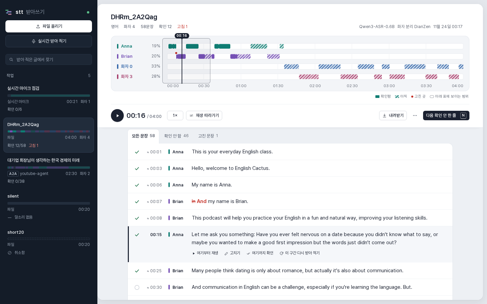
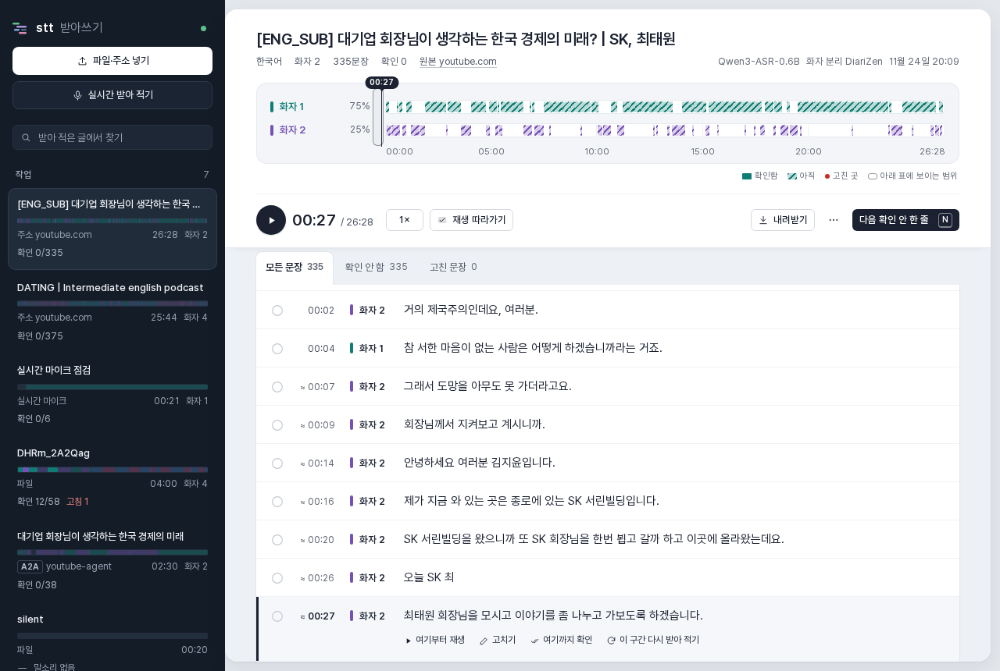
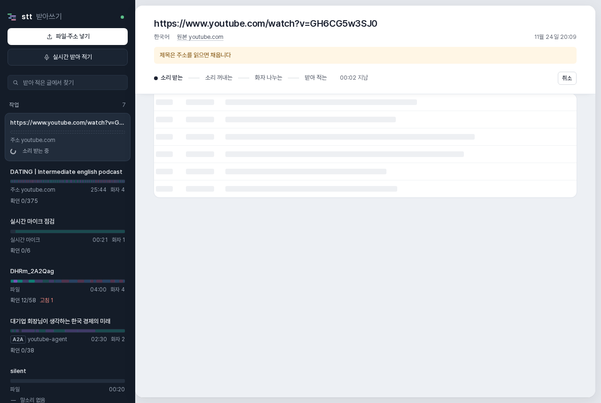
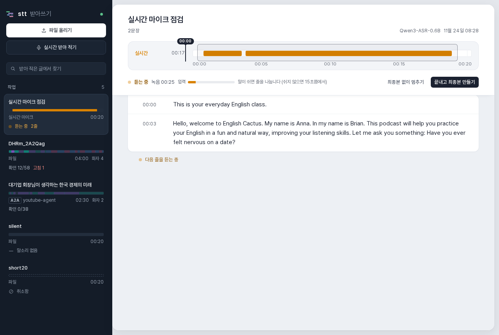
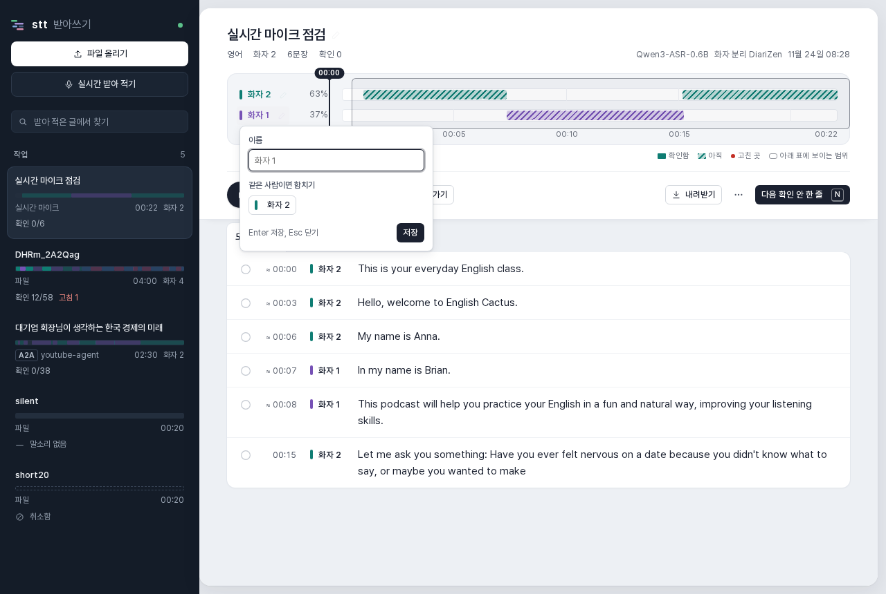

# stt — 이 PC의 모델로 받아 적는 받아쓰기 (화자·문장 시각, 파일·주소·실시간)

유튜브 영상, 팟캐스트, 회의 녹음을 **이 PC의 음성 인식 모델로** 글로 받아 적는다.
화자를 나누고, 문장마다 시각을 붙이고, 사람이 소리를 들으며 확인·고칠 수 있게 한다.

- **넣는 것**: 소리·영상 파일 / 유튜브 같은 **영상 주소**(소리만 받음, 제목·설명을 맥락으로 씀) / **실시간**(브라우저 마이크, 방송 스트림 주소)
- **나오는 것**: 화자와 시각이 붙은 글(.txt), 자막(.srt), 구간(.json). 화면에서 고친 내용이 그대로 반영된다.
- **쓰는 방법은 셋**: **화면**(사람), **A2A**(다른 에이전트가 HTTP로 일을 맡김), **import·CLI**(파이썬). 셋 모두 같은 서비스 함수를 부른다.
  그래서 다른 에이전트가 맡긴 일도 화면 목록에 보이고, 사람이 이어서 확인·고친다.

> **상태: 초기 버전.** 만든 사람의 기록이고 아직 오래 써 보지 않았다. 아래 숫자는 이 PC(RTX 4090)에서 2026-11-23~24에 잰 값이다.
> 정확도는 업로더 자막이 있는 한국어 유튜브 **한 편**으로 쟀다 (아래 "엔진 비교"). 더 많은 영상으로는 아직 재지 않았다.

- **로컬 전용**: 서버는 127.0.0.1에만 뜨고, 녹음과 받아 적은 글은 `data/`(SQLite 한 파일 + 소리 파일)에만 남는다.
  밖으로 나가는 것은 **주소로 넣을 때 그 주소에서 소리를 받는 것** 하나뿐이다. 받아 적기는 이 PC 안에서 한다.

| 25분 44초 영어 팟캐스트를 주소로 | 26분 28초 한국어 인터뷰를 주소로 | 4분 영어 파일 |
|---|---|---|
| 84초 (소리 받기 + 화자 분리 + 받아 적기), 375문장, 화자 4 | 108초, 335문장, 화자 2 | 26초, 58문장, 화자 4 |

## 화면


맨 위는 **화자별 트랙**이다. 말한 구간이 블록이고, 확인한 구간은 채워지고 아직인 구간은 빗금, 고친 곳은 빨간 점이다.
재생 위치는 시각 표지가 달린 세로선이다. 아래는 문장 표다. 문장을 누르면 그 시각부터 재생되고, 재생 중인 줄에는 동작(여기부터 재생·고치기·여기까지 확인·이 구간 다시 받아 적기)이 늘 보인다.

- **확인**: "확인 안 함" 탭, `N`(다음 확인 안 한 줄), 여기까지 확인. 확인한 만큼 트랙과 왼쪽 목록의 작은 테이프가 채워진다.
- **고치기**: 고친 글은 지운 글(빨간 줄)과 넣은 글로 남고, 받아 적은 원래 글로 되돌릴 수 있다.
- **화자**: 트랙의 화자 이름을 누르면 이름 붙이기와 **같은 사람 합치기**(화자 분리가 한 사람을 둘로 나눴을 때).
- **내려받기**: 글(.txt 시각·화자 포함) · 자막(.srt) · 구간(.json). 위험한 동작(전체 다시 받아 적기, 지우기)은 `⋯` 메뉴에.


왼쪽 콘솔의 **파일·주소 넣기**, 또는 화면 아무 곳에나 주소를 붙여 넣으면 넣기 창이 열린다. 제목·설명·채널 이름은 영상에서 읽어 채운다.

| 소리 받는 중 | 실시간 받아 적기 | 화자 정리 |
|---|---|---|
|  |  |  |
| 단계(소리 받기 → 꺼내기 → 화자 나누기 → 받아 적기)와 취소 | 말이 쉬면 줄이 생기고, 끝내면 녹음 전체로 최종본(화자·문장 시각)을 다시 만든다 | 이름 붙이기, 같은 사람 합치기 |

## 처음 쓰는 사람

```bash
# 두 저장소를 나란히 받는다 (stt 가 ../doc_reader 의 A2A 창구를 쓴다)
git clone https://github.com/Taeksu-Kim/stt.git
git clone https://github.com/Taeksu-Kim/doc_reader.git
(cd doc_reader && pip install --config-settings editable_mode=compat -e ./doc_parser)   # A2A 창구 (doc_parser.a2a)
pip install -r stt/requirements.txt           # 서버: fastapi · uvicorn · python-multipart · httpx (테스트: pytest · playwright)

# 받아 적기 엔진은 따로 둔 파이썬 환경에 (torch·모델 패키지를 서버 환경과 섞지 않는다)
conda create -n voice-eval python=3.12 -y
conda run -n voice-eval pip install -r stt/requirements-engine.txt   # qwen-asr · faster-whisper · soundfile · torch

cd stt && python -m stt serve                 # http://127.0.0.1:8773
```

- 시스템에 **ffmpeg**가 있어야 한다. 주소로 넣으려면 **yt-dlp**도 (`pip install yt-dlp`).
- 모델(Qwen3-ASR-0.6B, Whisper large-v3-turbo)은 처음 한 번 받는다: `python -m stt transcribe <파일> --allow-download`.
  그 뒤로는 기본이 오프라인이다(로컬에 없는 모델을 몰래 받지 않는다).
- **화자 분리**는 [DiariZen](https://github.com/BUTSpeechFIT/DiariZen) CLI를 따로 설치해 `stt/models.json`의 `diarizen.command`에 경로를 적는다.
  없어도 받아 적기는 되고, 시각이 15초 조각 단위가 되며 화면에 "화자 분리 엔진을 쓸 수 없어 화자 없이 받아 적었습니다"가 뜬다.
  DiariZen 모델 가중치는 CC BY-NC 4.0(비상업)이다.

### 엔진 등록부 `stt/models.json` — 모델·경로를 바꾸는 곳
경로는 이 저장소를 만든 PC 기준이다. 다른 PC에서는 이 파일을 고치거나 `STT_MODELS=<json 경로>`로 다른 파일을 쓴다.

- `engines.<이름>`: `runner`(`qwen`·`faster_whisper`·`diarizen`), `python`(그 엔진을 돌릴 환경) 또는 `command`, `model`(HF id 또는 경로),
  `languages`, `vram_mib`(필요한 GPU 메모리).
- `prefer`: 받아 적기 엔진의 정확도 순서. 언어·모델 있음·환경 있음·**GPU 여유**를 통과한 첫 엔진을 쓰고, 실행 중 실패하면 다음 후보로 넘어간다.
  지금은 Qwen3-ASR-1.7B → 0.6B → Whisper large-v3-turbo.
- `downloader`: 주소를 받을 yt-dlp.
- 엔진이 없거나 GPU가 모자라면 서버는 뜨고 받아 적기만 잠긴다. 콘솔의 점을 누르면 엔진마다 못 쓰는 이유가 보인다.
  같은 내용을 `python -m stt transcribe --dry-run <파일>`로도 볼 수 있다.

## 엔진 비교 (2026-11-25, 한국어 유튜브 12분 45초, 업로더 자막 = 정답)

뜻이 바뀐 오류만 셌다. 숫자 표기·띄어쓰기·군말 차이는 빼고, 세 결과를 A·B·C로 가려 Claude Haiku가 판정했다.
문장이 통째로 빠졌는지는 스크립트로 대조했고, 결과를 좌우하는 판정은 원문과 직접 확인했다.

| 엔진 | 뜻이 바뀐 오류 | 문장 통째 빠짐·지어냄 | 받아 적기 | GPU 최고 |
|---|---|---|---|---|
| **Qwen3-ASR-1.7B** (기본) | **14** | 없음 | 31초 | 7.5GB |
| Whisper large-v3-turbo | 18 | 핵심 답 두 문장 빠짐, 제목·"감사합니다" 지어 넣음 | 18초 | — |
| Qwen3-ASR-0.6B | 31 | 없음 | 33초 | 4.8GB |

- Whisper는 단어는 정확한 편이지만, 빠지고 지어낸 문장이 매끄럽게 읽혀 눈치채기 어렵다. 분석에 넘길 글로는 그래서 1.7B를 기본으로 둔다.
- 글자 오류율로만 보면 Whisper 4.6%, 0.6B 6.5%였다. 숫자를 "8주"로 쓰는 자막 표기가 Whisper에 유리하게 작용했다.
- **화자 분리(DiariZen)가 GPU를 가장 많이 쓴다** (이 영상 13.7GB). 로컬 LLM 서버(약 19GB를 잡아 둠)가 떠 있으면 화자 분리와 1.7B가 들어가지 못한다.
  그때는 고르기 단계에서 빠져 화자 없이, 또는 Whisper로 내려간다. 그래서 받아 적기를 먼저 하고 LLM 서버를 켠다.

## 어떻게 받아 적나

1. 소리를 16kHz mono로 꺼낸다 (주소면 먼저 소리만 받는다).
2. **화자 분리**로 누가 언제 말했는지 구간을 얻는다. 같은 화자가 1초 미만으로 쉬고 이어 말하면 합친다.
3. 구간을 조용한 지점에서 15초 이하 조각으로 잘라 **조각째로 받아 적는다**.
   - Qwen3-ASR을 패키지 기본값(20분 조각 · 출력 512토큰)으로 두면 긴 오디오의 뒷부분이 잘린다. 5.7분 한국어에서 737자만 나왔다.
   - 30·15·10초를 비교했을 때 15초가 단어 오류가 가장 적었다.
   - 말이 쉬는 곳(0.6초)에서 잘라 인식하면 오히려 단어 오류가 늘었다. 그래서 쉼 감지(VAD)는 시각 계산에만 쓴다.
4. 조각 글을 문장으로 나누고, 글자 비율을 조각 안의 **말소리 시간**(쉼 제외)에 배분해 문장 시각을 추정한다.
   - 추정한 시각은 `≈`를 붙인다. 영어 31문장을 Whisper 시각과 대 보니 오차가 평균 0.27초, 최대 1.14초였다.
5. **실시간**은 반대로 동작한다. 말이 0.6초 쉬면 끊어 바로 받아 적고, 쉬지 않으면 15초 근처의 가장 조용한 지점에서 끊는다.
   끝나면 녹음 전체를 1~4로 다시 받아 적어 최종본을 만든다.
   - 지연(말이 끝나고 줄이 뜨기까지)은 평균 1.6초, 최대 2.7초였다 (영어 60초).

## 다른 에이전트가 쓰기 (A2A) · import · CLI

- **A2A** (`/.well-known/agent-card.json`, JSON-RPC `/a2a`): 기능 `transcribe`.
  - 넣는 것: 파일 part(raw base64), `file://` 경로, `data.path`, **https 주소**(url part 또는 `data.url`).
    선택 값은 `lang` · `context` · `numSpeakers` · `speakers` · `title` · `force`.
  - 처음엔 WORKING이다. `GetTask`로 다시 물어 끝났으면 COMPLETED와 함께 artifact(글 + 구간 data)와 `metadata.reviewUrl`(사람이 확인할 화면)을 돌려준다.
  - 같은 `messageId`는 같은 작업이다. 화면에서 사람이 고친 글이 A2A 결과에도 그대로 나간다.
  - **같은 영상은 다시 받아 적지 않는다.** `messageId`가 달라도, 같은 영상(유튜브는 영상 ID — `watch?v=` · `youtu.be/` · `shorts/` ·
    `&t=`·`&list=` 같은 변형이 모두 같다, 그 밖은 주소 그대로)을 이미 받아 적었거나 받아 적는 중이면 새 A2A 작업이 그 작업을 가리킨다
    (`metadata.reused: true`, 끝났으면 바로 COMPLETED). 실패·취소한 작업만 있거나, 언어를 다르게 정했거나, 화자 분리 없이 한 것에 화자 분리를 원하면 새로 한다.
    일부러 새로 하려면 `data.force: true`.
  - 결과의 `metadata.video`와 artifact `meta.video`에 영상 정보가 있다: `video_id` · `channel` · `upload_date`(YYYY-MM-DD) · `duration` · `site` · `webpage_url`.
- **제품 API**: `POST /api/jobs/url` `{url, lang?, context?, num_speakers?, speakers?, title?, force?}` — 응답은 작업 요약에 `reused`(같은 영상의
  기존 작업을 돌려줬나)가 붙는다. 판단은 A2A와 같다(서비스 한 곳). 작업 요약의 `video`·`source_key`에 영상 정보와 출처 키가 있다.
- **import**: `from stt.engine import Engine` — `select` · `fetch` · `prepare` · `diarize` · `transcribe` · `live`를 단계별로 부를 수 있다.
- **CLI** (서버 없이):
  - `python -m stt transcribe <파일|주소> [--lang ko] [--context "제목·용어"] [--num-speakers N] [--no-speakers] [--out-dir D]`
  - `python -m stt live <방송 주소|장치|파일|-> [--duration 600] [--realtime] [--no-final]`
  - 결과는 `<이름>.stt/` 폴더의 `segments.json` · `transcript.txt` · `subtitle.srt`다. 같은 조건이면 다시 돌리지 않는다(`--force`로 다시).
    유튜브 주소는 `<영상 ID>.<확장자>`와 `<영상 ID>.info.json`(영상 정보)으로 받아 두고, 같은 영상이 다시 오면 받지 않는다.

## Claude Code 스킬

`.claude/skills/stt/` — Claude Code가 이 도구를 제대로 쓰게 하는 스킬이다 ("이 유튜브 받아 적어", "자막 만들어" 같은 요청에 불린다).
- 순서: 엔진이 준비됐는지 확인 → 서버(사람 확인·A2A)와 CLI(파일만) 중 고르기 → 실행 → 결과 확인.
- 사람에게는 화면 링크를 같이 준다.
- 실제로 겪은 함정이 들어 있다: 긴 오디오 뒷부분 잘림, 화자 수 짐작, GPU를 다른 작업과 나눠 쓸 때 등.
- 결정과 실패 기록은 같은 폴더 `NOTES.md`.

이 저장소 폴더에서 Claude Code를 열면 바로 쓰인다. 다른 작업 폴더에서 쓰려면 그 폴더의 `.claude/skills/stt`를 이 폴더로 링크한다.
스킬은 자기 위치에서 저장소 루트(세 단계 위)를 찾는다.

## 개발

- 층: 엔진 `stt/engine.py`(단계) → 서비스 `stt/service.py`(상태의 유일한 주인, SQLite) → 제품 API `stt/app.py` · A2A `stt/a2a_tasks.py`.
  엔진 프로세스 `stt/engine_run.py`는 등록부의 엔진 환경에서 따로 뜬다.
- `pytest`: 제품 API·A2A 진입점 테스트로, 모델만 가짜다(16개).
  같은 요청 2회, 빈·여러 파일, 취소, 재시작 후 이어서, 엔진 꺼짐, 실시간, 주소(받기 실패·받는 중 취소·다시 받지 않기),
  같은 영상 다시 옴(주소 변형·force·실패만 있음·진행 중·언어·화자 분리·A2A 다른 messageId), 옛 스키마 DB 이주를 다룬다.
- `python tools/browser_check.py --base <서버> --en … --ko … --short … --mic … --silent … --shots <폴더> [--url <영상 주소>]`
  - 실제 엔진 서버에 실제 브라우저로 과업 31개를 눌러 본다. 실시간은 가짜 마이크에 실제 음성 파일을 넣는다.
- 화면 설계·평가 과정(시안, 회차별 평가, 측정): [`docs/history/2026-11-23_screen-design/`](docs/history/2026-11-23_screen-design/README.md),
  콘셉트 카드: [`docs/design/concept.md`](docs/design/concept.md).

## 폴더

| 경로 | 내용 |
|---|---|
| `stt/` | 엔진·서비스·서버·A2A·CLI, `models.json`(엔진 등록부), `static/`(화면 한 장 + Pretendard 글꼴) |
| `tests/` | 진입점 테스트 (모델만 가짜) |
| `tools/browser_check.py` | 실제 브라우저 과업 점검 |
| `docs/` | 화면 캡처, 콘셉트 카드, 작업 기록 |
| `data/` | 녹음·받아 적은 글 (git 제외) |

## 라이선스

Apache-2.0 (`LICENSE`). 의존하는 것과 따로 받는 모델의 라이선스는 `NOTICE`.
화면 글꼴 Pretendard(SIL OFL 1.1)는 고치지 않은 원본 파일을 `stt/static/fonts/`에 함께 둔다.
